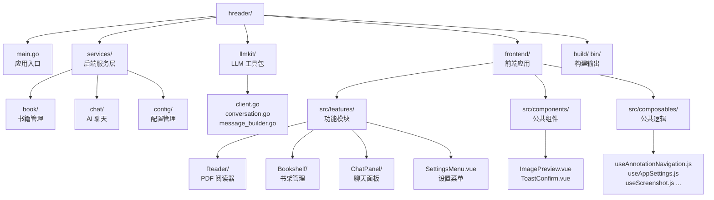

# H-Reader: AI辅助 阅读器

<div align="center">

**哪里不会点哪里的 PDF 阅读器**

[](https://golang.org/)
[](https://vuejs.org/)
[](https://wails.io/)
[](LICENSE)

</div>

## 项目简介

H-Reader 是一款基于 Wails v3 构建的跨平台桌面 PDF 阅读器，集成了 AI 对话功能。它采用 Go + Vue.js 技术栈，提供流畅的 PDF 阅读体验和智能化的学习辅助功能。

### 核心特性

- **PDF 管理** - 便捷的 PDF 文件管理和浏览
- **流畅阅读** - 高性能 PDF 渲染引擎，支持缩放、翻页、文本选择
- **便捷截图** - 支持整页截图和区域框选截图（快捷键 `Ctrl+Q`）
- **智能标注** - 在 PDF 上放置大头针标记，快速定位重要内容
- **AI 对话** - 集成大语言模型，支持针对 PDF 内容的智能问答
- **本地存储** - 聊天记录和本地标注本地保存，随时回顾
- **现代 UI** - 简洁美观的用户界面，支持深色主题
- **跨平台** - 基于 Wails，支持 Windows、macOS、Linux

## 技术架构

### 后端 (Go)
- **框架**: Wails v3 (Alpha) - 现代化的 Go 桌面应用框架
- **PDF 处理**: 通过前端 pdfjs-dist 库处理
- **AI 集成**: OpenAI API 兼容接口
- **数据存储**: 本地 JSON 文件存储聊天记录
- **分层架构**: services/ 目录下的模块化服务层
  - `book/` - 书籍管理、标注、阅读进度服务
  - `chat/` - 聊天会话、消息处理、存储服务
  - `config/` - 应用配置管理服务

### 前端 (Vue.js)
- **框架**: Vue 3 Composition API
- **构建工具**: Vite 5
- **PDF 渲染**: pdfjs-dist 5.x
- **Markdown 渲染**: markdown-it + highlight.js
- **公式渲染**: KaTeX 0.16.x
- **UI 组件**: 自定义 Toast 确认框、图片预览组件

### 项目结构



> 详细文件清单和说明请查看 [PROJECT_STRUCTURE.md](PROJECT_STRUCTURE.md)

## 快速开始

### 方式一：直接使用

1. 下载最新版本的 `hreader.exe`
2. 双击运行即可
3. 在应用内设置页面配置你的 API Key


---

### 方式二：从源码编译

#### 环境要求

- **Go**: 1.25 或更高版本
- **Node.js**: 18.x 或更高版本（用于前端构建）
- **Wails CLI**: `go install github.com/wailsapp/wails/v3/cmd/wails3@latest`

#### 编译步骤

```bash
# 1. 克隆仓库
git clone <repository-url>
cd hreader

# 2. 一键编译
wails3 build

# 编译完成后，可执行文件位于 bin/ 目录
```


### 方式三：开发调试

```bash
# 启动开发模式（支持热重载）
wails3 dev

# Wails 会自动：
# - 安装前端依赖
# - 启动 Vite 开发服务器
# - 编译并运行 Go 后端
# - 实现前后端热重载
```

---


## 功能详解

### 快捷键参考

| 快捷键 | 功能 | 说明 |
|--------|------|------|
| `Ctrl+Q` / `Cmd+Q` | 框选截图 | 在阅读器视图中快速启动区域截图 |
| `Shift+Enter` | 发送消息 | 在聊天输入框中发送消息 |
| `Ctrl+Enter` / `Cmd+Enter` | 发送消息 | 备选发送快捷键 |
| `Ctrl+滚轮` / `Cmd+滚轮` | 缩放 PDF | 放大或缩小 PDF 页面 |
| `ESC` | 取消操作 | 取消截图选择或大头针放置 |

---

### PDF 阅读器

#### 核心功能
- **懒加载渲染**: 使用 Intersection Observer API 实现按需渲染，提升性能
- **高分辨率支持**: 自动适配 Retina/高 DPI 屏幕
- **文本层**: 支持文本选择和复制
- **平滑滚动**: 优化的滚动体验和页码跟踪
- **公式跳转导航**: 点击公式编号自动跳转到对应位置

#### 交互操作
- **缩放**: 
  - Ctrl/Cmd + 滚轮缩放
  - 放大/缩小按钮
  - 适应宽度
- **导航**:
  - 滚动自动切换页码
  - 跳转到指定页
  - 上一页/下一页
  - 公式编号点击跳转
- **截图**:
  - 整页截图
  - 区域框选截图（拖动鼠标选择区域）
  - **快捷键**: `Ctrl+Q` / `Cmd+Q` 快速启动框选截图
- **标注**:
  - 在 AI 对话中点击”标记位置”按钮
  - 左键点击 PDF 页面放置大头针
  - 右键取消标记放置
  - 双击大头针跳转到对应对话
  - 右键大头针删除标记
  - 支持在多页面同时可见时任意页面放置标注

### AI 聊天

- **流式响应**: 实时显示 AI 回复
- **上下文管理**: 自动维护对话历史
- **Markdown 支持**: 格式化显示代码和文本
- **LaTeX 公式**: 支持数学公式渲染（KaTeX）
- **图片预览**: 点击聊天中的图片可放大预览
- **消息操作**: 支持编辑和删除历史消息（带确认框）
- **本地存储**: 聊天记录持久化保存
- **快捷操作**:
  - `Shift+Enter` / `Ctrl+Enter` / `Cmd+Enter` 发送消息
  - 截图自动添加到聊天附件（如果聊天面板打开）
  - 大头针双击跳转到对应对话并滚动到该消息

### 首次启动引导

- **新用户引导**: 首次启动时显示引导界面
- **API Key 配置**: 引导用户配置 AI 模型 API Key
- **预设模型选择**: 提供常用模型预设列表
- **文件夹选择**: 设置 PDF 书籍存储位置


## 许可证

本项目采用 **Apache License 2.0** 许可证

详细条款请参见 [LICENSE](LICENSE) 文件

### 简要说明

- 允许商业使用
- 允许修改和分发
- 允许专利使用
- 需要保留版权声明和许可证副本
- 修改的文件需要标注变更说明

## 致谢

- [Wails](https://wails.io/) - 优秀的 Go 桌面应用框架
- [Vue.js](https://vuejs.org/) - 渐进式 JavaScript 框架
- [PDF.js](https://mozilla.github.io/pdf.js/) - Mozilla 的 PDF 渲染库
- [pdfjs-dist](https://www.npmjs.com/package/pdfjs-dist) - PDF.js 的 NPM 包

---

<div align="center">

**Made with Wails + Vue.js**

如有问题或建议，欢迎提 Issue！

</div>
